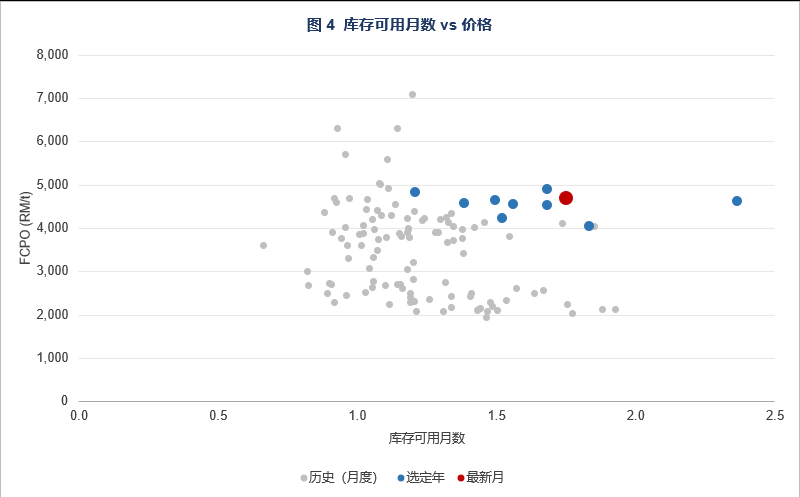

# Zhuoran Wang

URL · /ms.html

Calon Sarjana Pemasaran · Universiti Malaya

## Penyelidikan komoditi dan perniagaan rentas sempadan

Saya meneliti imbangan bekalan dan permintaan, spread dan keluk niaga hadapan komoditi. Di CITIC Futures, saya menyediakan bahan perniagaan dwibahasa. Di TusStar Malaysia, saya membina laman pengurusan keahlian dan menulis SOP serah tugas.

## Projek pilihan

### Mengapa harga minyak sawit bertahan apabila stok mencecah paras tertinggi dalam sepuluh tahun?

Komoditi pertanian

Stok Malaysia dan harga FCPO sama-sama tinggi. Saya meneliti liputan stok, spread tenaga dan margin import China untuk memahami perbezaan ini.

/work/palm-oil-ms.html

Kajian bebas

Baca kajian kes

Data MPOB hingga Oktober 2026

### Lima kontrak dalam satu rangka kerja margin kilang keluli

Komoditi ferus

Saya menggunakan anggaran margin kilang untuk menghubungkan harga keluli tetulang dan gegelung gulung panas dengan pengeluaran relau serta permintaan bijih besi, kok dan arang kok.

/work/ferrous-ms.html

### Daripada data niaga hadapan China kepada bahan perniagaan dwibahasa

Perniagaan institusi

Di ibu pejabat CITIC Futures, saya menyediakan statistik pasaran, bahan akses pasaran dan penyelidikan institusi untuk pasukan perniagaan antarabangsa.

/work/citic-futures-ms.html

### Daripada semakan keahlian kepada proses operasi yang didokumenkan

Operasi dan sistem

Saya menyepadukan rekod lama, cadangan perkhidmatan rentas sempadan, laman pengurusan dan SOP dari pendaftaran hingga pembaharuan serta penamatan keahlian.

/work/tusstar-membership-ms.html

## Pengalaman kerja

### CITIC Futures

Pelatih Perniagaan Antarabangsa · Ibu Pejabat

Menyusun data niaga hadapan, menyediakan bahan QFI dwibahasa dan menulis ringkasan kajian institusi asing serta pelanggan industri.

/work/citic-futures-ms.html

### TusStar Malaysia

Pelatih Pentadbiran dan Operasi

Menyediakan cadangan dan SOP keahlian, membina laman pengurusan dan menyokong program padanan industri.

/work/tusstar-membership-ms.html

### GF Securities

Pelatih Jualan Produk Dana Persendirian

Mempelajari produk dana dan proses jualan serta menyediakan nota laporan ETF dan istilah kewangan.

Kuala Lumpur, Malaysia

Laman latihan perniagaan institusi

LinkedIn
