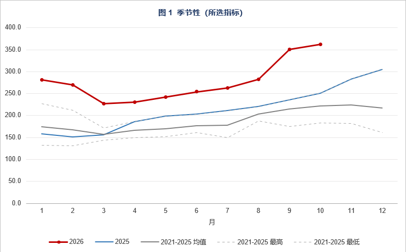
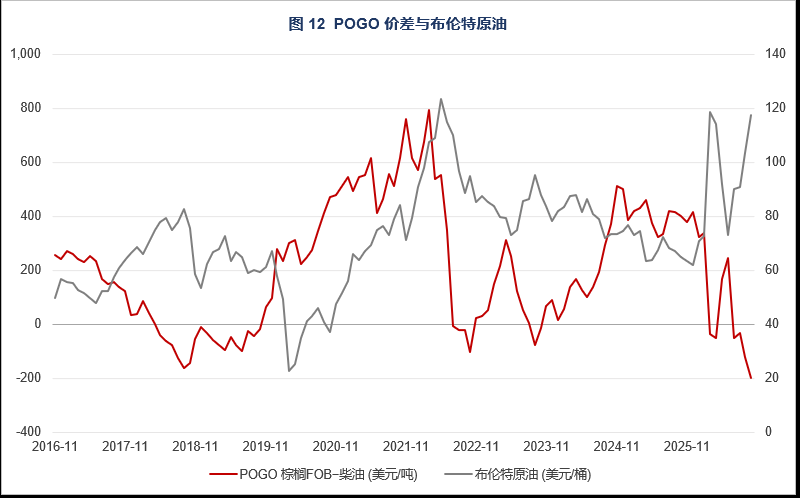
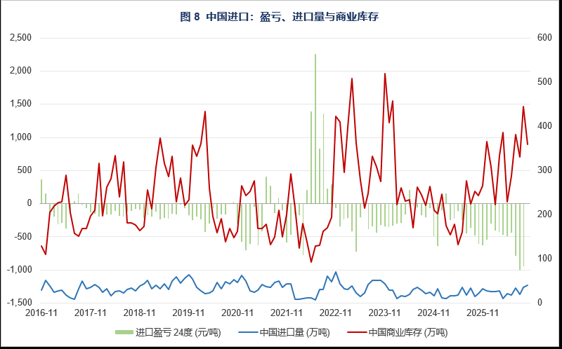

# Why didn’t palm oil fall as stocks hit a ten-year high?

URL · /work/palm-oil-en.html

Agricultural commodities · MPOB data through October 2026

Malaysian stocks and FCPO prices were both elevated. I used inventory coverage, energy spreads and Chinese import margins to investigate the divergence.

Zhuoran Wang

- **3.62m tonnes** · October closing stocks in Malaysia
- **1.75 months** · October inventory coverage
- **MYR 4,681/t** · October FCPO monthly settlement

## Analysis and deliverables

### Put the stock build in seasonal context

I used the monthly balance in the companion workbook and divided closing stocks by exports plus domestic use. As demand fell, coverage rose to 2.37 months in September. It eased to 1.75 in October as demand recovered, even as absolute stocks rose to about 3.62 million tonnes.

### Separate fuel and food demand

October FCPO settled at MYR 4,681 per tonne in the monthly series. I used the POGO spread between palm oil FOB and diesel as a gauge of biodiesel blending economics. I checked food demand separately using Chinese import margins and price spreads to soybean and rapeseed oil. The report recorded a September import margin of −CNY 951 per tonne.

### Turn the thesis into a monitoring plan

The report argued that higher diesel prices improved blending economics and offset part of the pressure from inventories. I tracked Brent and POGO alongside MPOB stocks, exports and arrivals in China, keeping the latest available month explicit for each series.

### Build the research into an updating workbook

In Commodity Spread Tracker I separated live Wind inputs, daily snapshots stored as values and monthly balances. The daily sheet calculates POGO, soybean–palm spreads and estimated import margins by destination. The curve tab compares the most recent FCPO futures curve with those from one week and one month earlier.

Figures from the original report and its Commodity Spread Tracker workbook (Wind EDB / MPOB / USDA).

Charts and figures reflect the research period.

## Selected work

- Five contracts, one steel mill margin framework · /work/ferrous-en.html

- Turning China futures data into bilingual business materials · /work/citic-futures-en.html

- From a membership review to a documented operating workflow · /work/tusstar-membership-en.html
