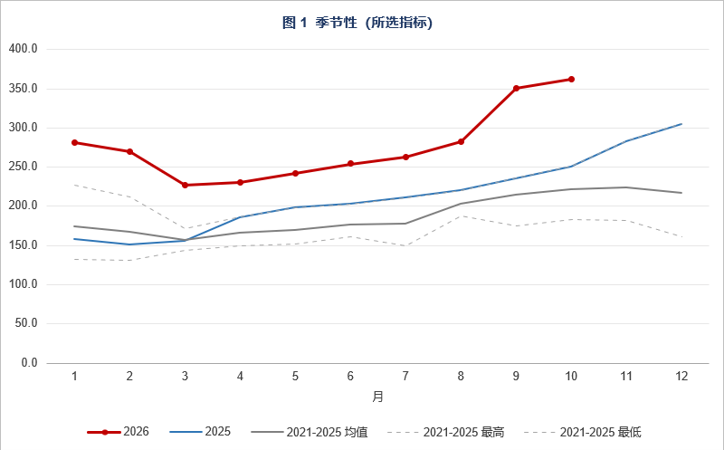
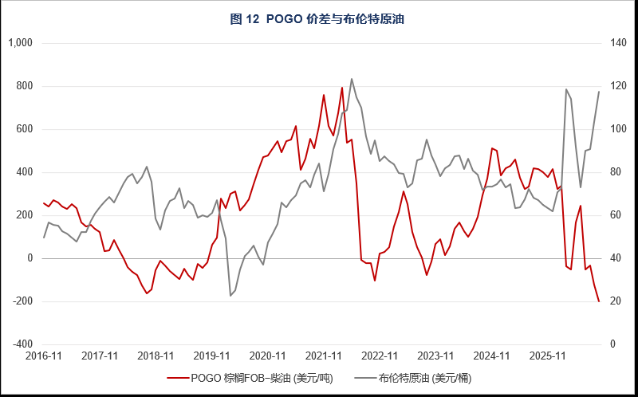
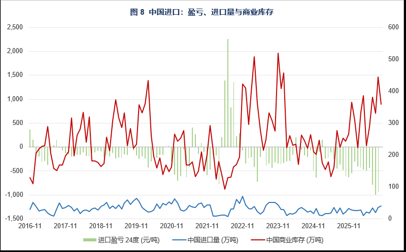

# Mengapa harga minyak sawit bertahan apabila stok mencecah paras tertinggi dalam sepuluh tahun?

URL · /work/palm-oil-ms.html

Komoditi pertanian · Data MPOB hingga Oktober 2026

Stok Malaysia dan harga FCPO sama-sama tinggi. Saya meneliti liputan stok, spread tenaga dan margin import China untuk memahami perbezaan ini.

Zhuoran Wang

- **3.62 juta tan** · Stok akhir Malaysia pada Oktober
- **1.75 bulan** · Liputan stok pada Oktober
- **MYR 4,681/tan** · Harga penyelesaian bulanan FCPO pada Oktober

## Analisis dan hasil kerja

### Bandingkan stok mengikut musim

Saya membahagikan stok akhir dengan jumlah eksport dan penggunaan domestik berdasarkan imbangan bulanan. Liputan stok meningkat kepada 2.37 bulan pada September apabila permintaan merosot. Pada Oktober, liputan turun kepada 1.75 bulan apabila permintaan pulih, walaupun stok mencapai kira-kira 3.62 juta tan.

### Bezakan permintaan bahan api dan makanan

Harga penyelesaian bulanan FCPO pada Oktober ialah MYR 4,681 setan. Saya menggunakan spread POGO antara harga FOB minyak sawit dan diesel untuk menilai ekonomi campuran biodiesel. Margin import China dan spread berbanding minyak soya serta minyak biji sesawi digunakan untuk menyemak permintaan makanan. Margin import September dalam laporan ialah −CNY 951 setan.

### Tentukan petunjuk susulan

Laporan itu mengemukakan bahawa harga diesel yang lebih tinggi memperbaik ekonomi campuran biodiesel dan mengimbangi sebahagian tekanan stok. Saya menjejaki Brent dan POGO bersama stok MPOB, eksport dan ketibaan di China, dengan tarikh rujukan masing-masing.

### Bina buku kerja yang boleh dikemas kini

Dalam Commodity Spread Tracker, saya mengasingkan data langsung Wind, rekod harian sebagai nilai dan imbangan bulanan. Helaian harian mengira POGO, spread soya–sawit dan anggaran margin import mengikut destinasi. Helaian keluk membandingkan keluk FCPO terkini dengan keluk seminggu dan sebulan sebelumnya.

Carta daripada laporan asal dan buku kerja Commodity Spread Tracker (Wind EDB / MPOB / USDA).

Carta dan angka merujuk kepada tempoh kajian.

## Projek pilihan

- Lima kontrak dalam satu rangka kerja margin kilang keluli · /work/ferrous-ms.html

- Daripada data niaga hadapan China kepada bahan perniagaan dwibahasa · /work/citic-futures-ms.html

- Daripada semakan keahlian kepada proses operasi yang didokumenkan · /work/tusstar-membership-ms.html
