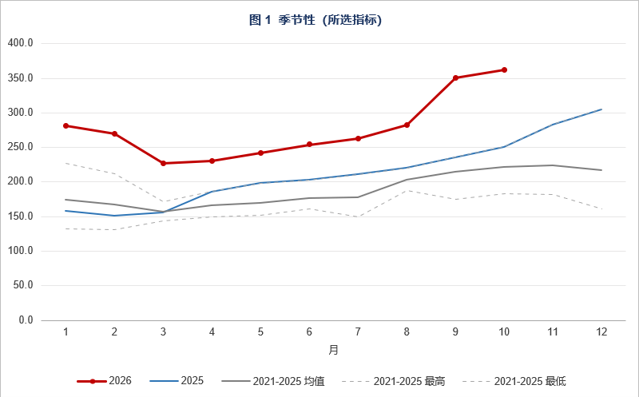
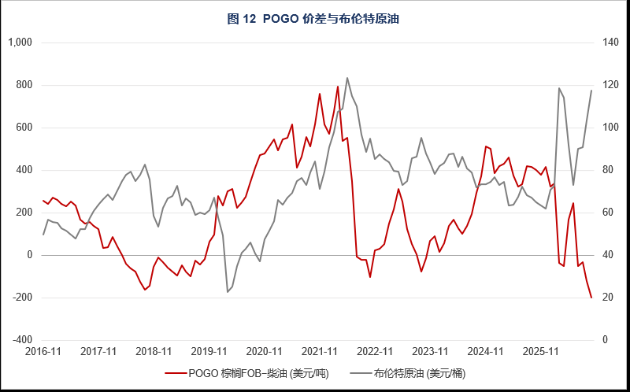
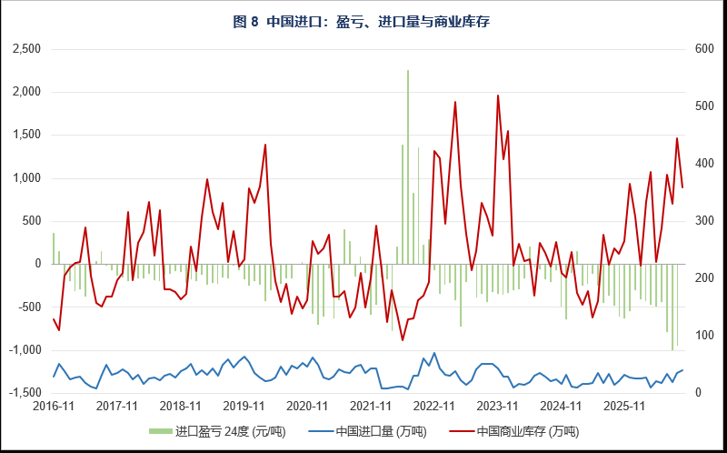

# 库存创十年新高，棕榈油为什么不跌？

URL · /work/palm-oil.html

农产品研究 · MPOB 数据截至 2026 年 10 月

同一张图上，马来西亚库存与 FCPO 价格都处在高位。我用库存可用月数、能源价差和中国进口盈亏解释这种背离。

汪卓燃

- **362 万吨** · 马来西亚 10 月期末库存
- **1.75 个月** · 10 月库存可用月数
- **RM 4,681/吨** · 10 月 FCPO 月度结算价

## 研究与交付

### 先把库存放回季节性里

我从报告配套工作簿的月度供需表提取数据，以期末库存除以出口与国内消费之和，比较不同年份的库存压力。2026 年 9 月需求回落，库存可用月数升至 2.37。10 月需求修复后，该指标降至 1.75，库存绝对量仍升至约 362 万吨。

### 把价格背离拆成两个市场

10 月 FCPO 月度结算价为 4,681 令吉/吨。报告用棕榈油 FOB 与柴油的 POGO 价差检验生物柴油需求的支撑，并用中国 24 度棕榈油进口盈亏及豆棕、菜棕价差交叉检查食用需求。报告记录的 9 月进口盈亏为 −951 元/吨。

### 写成可跟踪的情景

报告提出的解释是，柴油价格上升改善了生物柴油掺混经济性，部分抵消高库存压力。后续观察布伦特与 POGO 是否同步转向，同时核对 MPOB 库存、出口和中国到港量。不同序列各用自己的最近可用月份。

### 把研究过程做成可更新的工作簿

在 Commodity Spread Tracker 中，把 Wind 实时取数、日度数值快照和月度供需表分开。日度页计算 POGO、豆棕价差和不同到货地的测算进口利润。期限结构页比较最近交易日、一周前与一月前的 FCPO 曲线。

作者原报告图表，底表为 Commodity Spread Tracker（Wind EDB / MPOB / USDA）。

图表与数据为研究时点记录。

## 精选作品

- 把五个品种放进一条钢厂利润链 · /work/ferrous.html

- 把国内期货市场数据做成双语业务材料 · /work/citic-futures.html

- 从会员体系诊断到可以交接的运营流程 · /work/tusstar-membership.html
